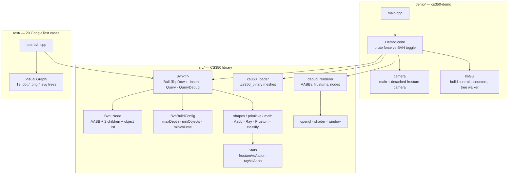
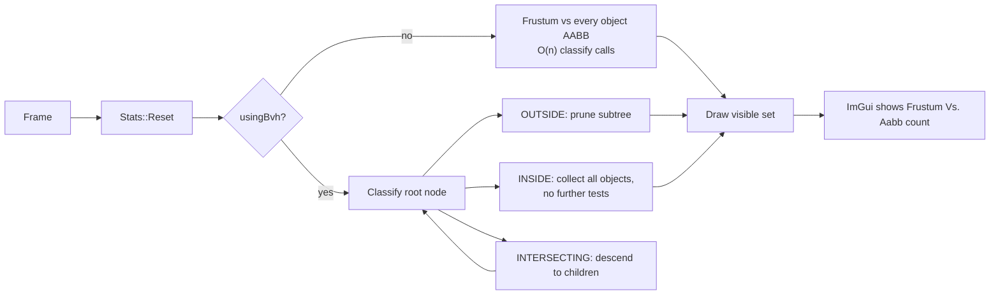

<div align="center">

# Bounding Volume Hierarchy

**A templated BVH in C++20 with two construction strategies, frustum and ray queries, and an OpenGL demo that counts every bounding-volume test so you can watch brute force lose.**


<sub>The demo application: the tree drawn over the scene, a detached frustum camera, and the live <code>Frustum Vs. Aabb</code> / <code>rayVsAabb</code> counters that make the speedup measurable rather than claimed.</sub>

</div>

---

## At a glance

- **One templated `Bvh<T>`** (`src/bvh.hpp` + `bvh.inl`, ~1,200 lines) usable with any object exposing an `Aabb bv`, an `id`, and intrusive list hooks.
- **Two construction strategies** on the same tree: top-down median splitting, and incremental insertion that picks its parent by branch-and-bound over an insertion cost.
- **Two query types**: frustum culling that early-accepts whole subtrees, and ray casting that returns either the closest hit or every intersection.
- **A built-in cost counter.** A `Stats` singleton tallies `frustumVsAabb` and `rayVsAabb` tests, and the demo lets you toggle the BVH off and compare against testing every object — the number in the panel *is* the benchmark.
- **20 GoogleTest cases** covering both builders, corner cases, cumulative insertion, rebuilds and random ray batteries.
- **19 trees dumped as Graphviz** `.dot`, `.png` and `.svg` under `BVH project/Visual Graph/`, one per test, so the structure each strategy produces can be inspected rather than imagined.

---

## Highlights

**The tree can explain itself.**
`DumpGraph` writes a Graphviz script for any tree, and the test suite calls it — every one of the 19 graphs in `Visual Graph/` is the exact tree a named test built. When an insertion heuristic misbehaves, the diff shows up as a differently shaped picture, not just a failing assertion. `DumpInfo` prints the same structure in readable text.

**Insertion is a cost search, not a descent.**
`Insert` does not simply walk to the nearest child. It explores candidate parents with a priority queue of `NodeCosts`, where each candidate's cost combines the volume the enclosing AABB would gain, the accumulated cost from the root, and a per-level penalty that biases the search toward balanced trees. Candidates whose best possible cost already exceeds the incumbent are pruned — a branch-and-bound insertion of the kind dynamic AABB trees use for physics broadphases.

**Top-down splits on the longest axis.**
`BuildTopDown` computes the node's bounds, takes `bv.longest_axis()`, partitions objects by centroid along it, and recurses until one of the `BvhBuildConfig` limits trips (`maxDepth`, `minObjects`, `minVolume`). Both builders share the config struct, so the same stopping rules can be compared across strategies.

**Frustum queries skip work three ways.**
`Query(Frustum)` classifies each node as outside, inside or intersecting. Outside prunes the subtree; **inside collects every object underneath without a single further test**; only intersecting nodes descend. That middle case is where a hierarchy earns its keep, and the `frustumVsAabb` counter shows exactly how often it fires.

**Ray queries that show their work.**
`QueryDebug` returns the closest hit as an `std::optional<unsigned>`, and also fills a list of every intersected object and every node it tested. The demo draws those tested nodes, so an inefficient tree is visible as a wide spray of highlighted boxes.

---

## Architecture



One frame of culling, with and without the hierarchy:



### Repository layout

| Path | Contents |
| --- | --- |
| `BVH project/src/bvh.hpp`, `bvh.inl` | The hierarchy: nodes, both builders, frustum and ray queries, traversal, Graphviz dumps |
| `BVH project/src/shapes.*`, `primitive.*`, `math.hpp` | `Aabb`, `Ray`, `Frustum`, intersection and classification routines |
| `BVH project/src/stats.hpp` | Test counters incremented by the intersection routines |
| `BVH project/src/cs350_loader.*` | Loader for the `.cs350_binary` mesh format |
| `BVH project/src/debug_renderer.*`, `shader.*`, `window.*`, `opengl.*` | Minimal OpenGL layer for drawing boxes, frustums and wireframes |
| `BVH project/demo/` | `DemoScene`, dual cameras, the ImGui control panel |
| `BVH project/test/` | 20 GoogleTest cases, plus the common scene fixtures |
| `BVH project/Visual Graph/` | `dot&txt/`, `png/`, `svg/` — 19 dumped trees, one per test |
| `BVH project/bin/assets/` | Meshes (`avocado`, `bunny`, `bunny-dense`, `dragon`, `suzanne`) and shaders |

---

## Testing

20 GoogleTest cases in `test/test-bvh.cpp`, split evenly across the two builders so they can be compared on identical inputs:

| Area | Cases | What they check |
| --- | --- | --- |
| `TopDown_*` | 9 | Single and paired AABBs, corner cases, clear, rebuild, random scenes, inside/outside placement, random ray batteries |
| `Insert_*` | 10 | The same scenarios through incremental insertion, plus manual trees and cumulative insertion order |
| `Unused` | 1 | Empty-tree behaviour |

Each case that builds a tree also dumps it to `Visual Graph/`, so a structural regression is visible as a changed graph.

```bash
cd build
ctest --output-on-failure
```

---

## Getting started

### Requirements

- CMake, a C++20 compiler (Visual Studio 2022 on Windows)
- [vcpkg](https://github.com/microsoft/vcpkg)

### Install dependencies

**Windows (x64):**

```powershell
.\vcpkg\vcpkg install glm:x64-windows glad:x64-windows glfw3:x64-windows lodepng:x64-windows gtest:x64-windows fmt:x64-windows imgui[glfw-binding,opengl3-binding]:x64-windows imguizmo:x64-windows stb:x64-windows
```

**Linux (x64):**

```bash
./vcpkg/vcpkg install glm glad glfw3 lodepng gtest fmt imgui[glfw-binding,opengl3-binding] imguizmo stb
```

### Build and run

```bash
git clone https://github.com/jazwinn/Spatial-Data-Structure-using-Bounding-Volume-Hierarchy-BVH-.git
cd "Spatial-Data-Structure-using-Bounding-Volume-Hierarchy-BVH-/BVH project"
mkdir build && cd build
cmake .. -DCMAKE_TOOLCHAIN_FILE=../vcpkg/scripts/buildsystems/vcpkg.cmake
cmake --build . --config Release
./cs350-demo.exe
```

### Driving the demo

| Control | Where | What it does |
| --- | --- | --- |
| **Build TopDown** / **Build insert** | BVH panel | Rebuild the tree with either strategy; **One** inserts a single object at a time |
| **Min objects** | BVH panel | `BvhBuildConfig::minObjects` — the leaf-size cutoff (the demo starts at 50) |
| **usingBvh**, **frustumCulling** | BVH panel | Toggle the hierarchy and culling off to compare against brute force |
| **Frustum Vs. Aabb** | BVH panel | Live count of bounding-volume tests for the current frame |
| **ray_debug**, **ray_only_closest** | BVH panel | Cast rays into the scene; draw every tested node, or stop at the closest hit |
| **Switch to Frustum Camera**, **Draw Frustum** | Camera header | Fly the second camera and watch its frustum cull the scene from outside |
| **Go L / Go R / Go Parent**, **Preview**, **Center** | Tree walker | Walk the hierarchy node by node and frame each one |

---

## Known limitations

- **`BuildBottomUp` is a declared stub** — only top-down and incremental insertion are implemented.
- **Model assets are not in the repository.** The `mirlo` scene used by several tests was removed for copyright reasons; the demo ships the `cs350_binary` meshes under `bin/assets/cs350/` instead. Get in touch for details on the full scene.
- **No committed benchmark numbers.** The counters make the comparison measurable, but the speedup over brute force is observed live in the panel rather than recorded here — a scripted run that writes a table would be the next step.
- **Insertion quality is not scored.** Tree depth and node count are available via `Depth()` and `Size()`, but nothing compares the two builders on surface-area cost automatically.
- The Graphviz dumps are stored as dot-prefixed (hidden) filenames, e.g. `Visual Graph/svg/.Insert_Manual01.dot.svg`.

---

## Roadmap

- [ ] Implement `BuildBottomUp` and compare all three strategies on one scene
- [ ] Surface Area Heuristic splitting alongside longest-axis median
- [ ] Scripted benchmark that writes a brute-force vs BVH table instead of a live counter
- [ ] Tree-quality metrics (depth, node count, SAH cost) reported per build

---

## Credits

Written for CS350 at DigiPen Institute of Technology (Singapore).
